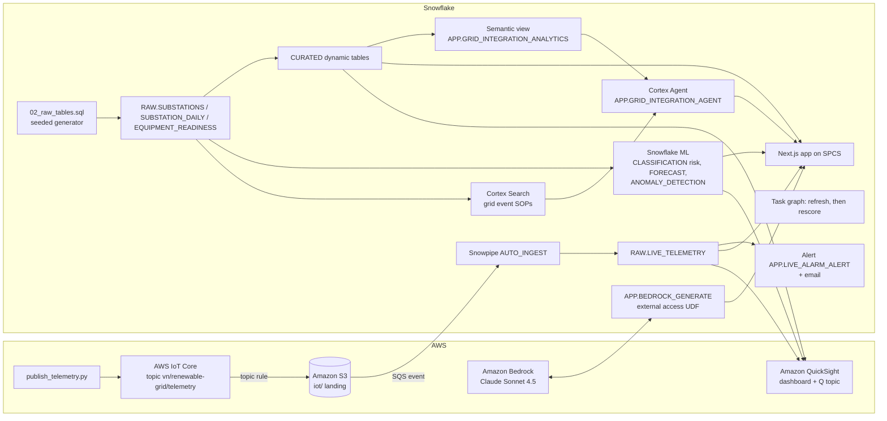

# Vietnam Renewable Grid Integration Monitor

Grid integration monitoring for a **fictional grid operator's 30 renewable connection substations across 6 Vietnam cities** (Phan Rang-Thap Cham, Quy Nhon, Bac Lieu, Tuy Hoa, Phan Thiet, Buon Ma Thuot) using Snowflake, optionally with AWS: from utility solar and onshore wind connections through nearshore wind to battery storage and solar-storage hybrid connections, with in-limit SCADA KPIs, a live busbar voltage alarm, a 7-day grid event-risk score, an alarm email and an AI action memo.

## Architecture

A grid integration monitoring pipeline built on **Snowflake** (Dynamic Tables, Snowflake ML, Cortex Search, Cortex Agent, Cortex AI_COMPLETE, SPCS) and, in the full build, **AWS** (IoT Core, S3, Bedrock Claude, QuickSight + Amazon Q). Substation SCADA readings (busbar voltage deviation, transformer loading) land in `RAW.LIVE_TELEMETRY`. Dynamic tables curate 90 days of substation-day history: SCADA samples, in-limit samples (voltage, frequency, power factor, harmonics and ramp rate all inside the connection-agreement band for the connection type), protection checks, protection alarms, grid events and connection availability. Snowflake ML scores 7-day grid event risk per substation, forecasts network-wide SCADA sample volume and flags busbar voltage deviation anomalies. A Cortex Agent answers questions with SOP citations, and an LLM drafts the grid operations action memo.

Interactive diagrams (hover for object names): [Snowflake only](docs/architecture-snowflake.html) | [AWS + Snowflake](docs/architecture-aws.html). The app shows both on its Architecture & Data tab, the current build first. Regenerate them with `python3 docs/build_architecture.py`.



The Snowflake-only build drops the AWS subgraph: `APP.SIMULATE_TELEMETRY` writes to `RAW.LIVE_TELEMETRY`, and the app calls Cortex `AI_COMPLETE` instead of the Bedrock UDF.

## Snowflake Capabilities

| Capability | Implementation |
|-----------|---------------|
| Dynamic Tables | `CURATED.KPI_SUMMARY`, `PERFORMANCE_SUMMARY`, `GRID_EVENT_CAUSES`, `TREND_ANALYSIS` from the RAW tables |
| Snowflake ML | CLASSIFICATION 7-day grid event risk (`ML.GRID_EVENT_RISK_SCORES`), 14-day SCADA sample volume FORECAST, busbar voltage deviation ANOMALY_DETECTION |
| Cortex Search | 20 synthetic grid event response SOPs (one per connection type and cause) in `SEARCH.SUBSTATION_SOP_SEARCH` |
| Semantic View | `APP.GRID_INTEGRATION_ANALYTICS` over substations, event causes, daily SCADA samples and risk |
| Cortex Agent | `APP.GRID_INTEGRATION_AGENT`: Cortex Analyst over the semantic view plus Cortex Search for SOP citations |
| Cortex AI | `AI_COMPLETE('claude-sonnet-4-5')` for grounded answers, and for the action memo in the Snowflake-only build |
| Alerts + Tasks | `APP.LIVE_ALARM_ALERT` logs ALARM readings and sends email; task graph `TASK_REFRESH_CURATED`, then `TASK_RESCORE_RISK` |
| Snowpark Container Services | Next.js app `APP.VN_RENEWABLE_GRID_APP` with 6 tabs: Executive Cockpit, Predictive, Substation Health, Live IoT, Ask AI, Architecture & Data |
| Snowpipe | `RAW.LIVE_TELEMETRY_PIPE` AUTO_INGEST from S3 (AWS build only) |

## AWS Services

Used only in the AWS + Snowflake build.

| Service | Role in Demo |
|---------|-------------|
| AWS IoT Core | Receives simulated substation SCADA telemetry (busbar voltage deviation, transformer loading). A topic rule writes each message to S3 |
| Amazon S3 | Landing bucket. An event notification goes to the Snowpipe SQS queue |
| Amazon Bedrock | Claude Sonnet 4.5 writes the action memo, called from Snowflake through an external-access UDF |
| Amazon QuickSight | DIRECT_QUERY executive dashboard over Snowflake (daily in-limit SCADA samples, grid events by substation, event risk) |
| Amazon Q | Natural-language questions over the QuickSight topic `vn-renewable-grid-topic` |
| AWS IAM | Least-privilege roles for S3, IoT and Bedrock |

## Personas

These personas are fictional.

| Persona | Role | Key Questions |
|---------|------|---------------|
| **Tran Minh Quan** | Grid Operations Director | "Which city has the lowest in-limit rate?" "Which event causes push the most samples out of limit?" |
| **Le Thi Ngoc Anh** | Control Room Dispatch Engineer | "Which substations are high event risk this week, and which SOP applies?" |

## Data

All data is synthetic and seeded, so every rebuild reproduces it. The grid operator, its substations and its network are fictional; the six cities are real Vietnam cities used as regions. No real utility, transmission company, power plant or facility is represented, and no grid code, connection agreement or regulatory compliance is claimed for any real site.

| Table | Rows | Description |
|-------|------|-------------|
| RAW.SUBSTATIONS | 30 | Grid connection substations across 6 cities and 5 connection types (Utility Solar, Onshore Wind, Nearshore Wind, Battery Storage, Solar-Storage Hybrid) |
| RAW.SUBSTATION_DAILY | 2,700 | Daily substation observations over 90 days: SCADA samples, in-limit samples, dispatch compliance, protection checks, protection alarms, grid events, root cause, PM, busbar voltage deviation and transformer loading |
| RAW.EQUIPMENT_READINESS | 30 | Inverter spare modules, converter spare modules, cable joint kits, battery cooling units or power quality meters required and on hand per substation |
| SEARCH.SUBSTATION_SOP_DOCS | 20 | Synthetic grid event response SOPs indexed for Cortex Search |
| RAW.LIVE_TELEMETRY | Grows during the demo | Live readings from IoT Core (AWS build) or `APP.SIMULATE_TELEMETRY` (Snowflake-only build) |
| ML.GRID_EVENT_RISK_SCORES | 30 | 7-day grid event probability and risk band per substation |

Event traceability: each substation-day carries in-limit samples and the dispatch compliance of the plants it connects, and every SOP asks the dispatch engineer to log the affected feeders and confirm SCADA values against the revenue meter.
## Build Instructions

### Prerequisites
- Snowflake account with ACCOUNTADMIN access, and Cortex AI enabled (AI_COMPLETE, Search, Agent).
- An X-Small warehouse with auto-suspend at or below 120 s, and an existing SPCS compute pool.
- Python 3.11+, `snowflake-connector-python`, Node.js 22+, Docker and the `snow` CLI.
- App image: run `snow spcs image-registry login`, then build and push `vn-renewable-grid-app:v1` to the database's `APP.IMAGES` repository (see the header of `snowflake/07_deploy_app.sql`).
- AWS build only: `boto3`, AWS credentials for the target account (us-west-2) with Bedrock access, and QuickSight Enterprise.

### SPCS App
```
<DATABASE>.APP.VN_RENEWABLE_GRID_APP
```

### Tests
```bash
python -m pytest aws snowflake quicksight
```

For a local run, put `SNOWFLAKE_ACCOUNT`, `SNOWFLAKE_USER`, `SNOWFLAKE_DATABASE`, `SNOWFLAKE_WAREHOUSE`, `SNOWFLAKE_AUTHENTICATOR=PROGRAMMATIC_ACCESS_TOKEN`, `SNOWFLAKE_TOKEN` and `DEMO_PLATFORM` in the environment, then run `npm --prefix app run build && npm --prefix app start`.

## Build Modes

Both modes share the same core. They differ in three places, and the app's `DEMO_PLATFORM` setting (in its SPCS spec) switches the memo provider and the Live IoT tab.

| Layer | Snowflake Only | Full AWS + Snowflake |
|---|---|---|
| Live telemetry | `CALL APP.SIMULATE_TELEMETRY(n)` inserts simulated readings into `RAW.LIVE_TELEMETRY`. This simulates a sensor feed; it is not Snowpipe Streaming | `aws/publish_telemetry.py` to AWS IoT Core, then S3, SQS and Snowpipe AUTO_INGEST |
| Action memo | Cortex `AI_COMPLETE('claude-sonnet-4-5')` | Amazon Bedrock Claude Sonnet 4.5 through `APP.BEDROCK_GENERATE` |
| BI and natural-language questions | The SPCS app is the dashboard; questions go to the Cortex Agent | Also a QuickSight dashboard and an Amazon Q topic |
| App setting | `DEMO_PLATFORM: snowflake` | `DEMO_PLATFORM: aws` |

### Snowflake Only

```bash
# 1. Core data and dynamic tables (guarded: new isolated database only)
python snowflake/run_core.py --database VIETNAM_RENEWABLE_GRID_SNOWFLAKE --warehouse <XS_WAREHOUSE> --connection <CONNECTION> --apply
# 2. Native telemetry, ML, search, semantic view, agent, alert and task graph
python snowflake/run_intelligence.py --database VIETNAM_RENEWABLE_GRID_SNOWFLAKE --platform snowflake --warehouse <XS_WAREHOUSE> --connection <CONNECTION> --alert-email you@example.com
# 3. App on SPCS with DEMO_PLATFORM=snowflake (push the image first)
python snowflake/run_intelligence.py --database VIETNAM_RENEWABLE_GRID_SNOWFLAKE --platform snowflake --warehouse <XS_WAREHOUSE> --connection <CONNECTION> --alert-email you@example.com --files 07_deploy_app.sql --compute-pool <COMPUTE_POOL>
```

During the demo:
- Run `CALL APP.SIMULATE_TELEMETRY(20)` to add live readings. For a continuous feed, run `ALTER TASK APP.TASK_SIMULATE_TELEMETRY RESUME`, and `SUSPEND` it afterwards.
- Run `EXECUTE ALERT APP.LIVE_ALARM_ALERT` to raise the alarm email.
- Run `EXECUTE TASK APP.TASK_REFRESH_CURATED` to refresh the curated tables and rescore risk.

Afterwards, drop the database or run `ALTER SERVICE APP.VN_RENEWABLE_GRID_APP SUSPEND`.

### Full AWS + Snowflake

```bash
# 1. Core data and dynamic tables (guarded: new isolated database only)
python snowflake/run_core.py --database VIETNAM_RENEWABLE_GRID_AWS --warehouse <XS_WAREHOUSE> --connection <CONNECTION> --apply
# 2. AWS ingestion and Bedrock (dry run first, then --apply)
python aws/setup_aws.py --database VIETNAM_RENEWABLE_GRID_AWS --account <AWS_ACCOUNT_ID> --connection <CONNECTION> --apply
# 3. ML, search, semantic view, agent, alert and task graph
python snowflake/run_intelligence.py --database VIETNAM_RENEWABLE_GRID_AWS --platform aws --warehouse <XS_WAREHOUSE> --connection <CONNECTION> --alert-email you@example.com
# 4. App on SPCS with DEMO_PLATFORM=aws (push the image first)
python snowflake/run_intelligence.py --database VIETNAM_RENEWABLE_GRID_AWS --platform aws --warehouse <XS_WAREHOUSE> --connection <CONNECTION> --alert-email you@example.com --files 07_deploy_app.sql --compute-pool <COMPUTE_POOL>
# 5. QuickSight dashboard and Q topic (needs an existing Snowflake data source)
python quicksight/build_dashboards.py --database VIETNAM_RENEWABLE_GRID_AWS --account <AWS_ACCOUNT_ID> --principal-arn <QUICKSIGHT_USER_ARN> --data-source-arn <DATA_SOURCE_ARN> --prefix vn-renewable-grid --apply --update --with-topic
```

QuickSight objects must be shared with the QuickSight user who signs in (`--principal-arn`); otherwise the console shows nothing.

During the demo:
- Run `python aws/publish_telemetry.py --count 20` to send live readings.
- Run `EXECUTE ALERT APP.LIVE_ALARM_ALERT` to raise the alarm email.
- Run `EXECUTE TASK APP.TASK_REFRESH_CURATED` to refresh the curated tables and rescore risk.

Afterwards, `python aws/teardown_aws.py --database VIETNAM_RENEWABLE_GRID_AWS --account <AWS_ACCOUNT_ID> --connection <CONNECTION> --apply` removes the AWS resources and the account-level Bedrock external-access and S3 storage integrations. It leaves the email integration `VN_RENEWABLE_GRID_EMAIL_INT`, which the Snowflake-only build also uses.

## Business Impact

Industry context from the International Energy Agency (IEA), *Electricity Grids and Secure Energy Transitions* (executive summary):

- **Grid connection is a bottleneck for renewables**: "At least 3 000 gigawatts (GW) of renewable power projects, of which 1 500 GW are in advanced stages, are waiting in grid connection queues" -- [IEA, Electricity Grids and Secure Energy Transitions](https://www.iea.org/reports/electricity-grids-and-secure-energy-transitions/executive-summary)
- **Variable renewables need more flexible operation**: "As the shares of variable renewables such as solar PV and wind increase, power systems need to become more flexible to accommodate the changes in output." -- [same IEA page](https://www.iea.org/reports/electricity-grids-and-secure-energy-transitions/executive-summary)
- **Outages are costly**: "Today, such outages already cost around USD 100 billion a year, or 0.1% of global GDP." -- [same IEA page](https://www.iea.org/reports/electricity-grids-and-secure-energy-transitions/executive-summary)

These are global industry figures, not outcomes of this demo or of any Vietnam grid operator.

## Key Demo Numbers

These figures are synthetic and come from the seeded demo data. Forecast and anomaly figures can shift slightly with the build day.

- **30 grid connection substations**, 2,700 substation-days over 90 days, across 6 cities and 5 connection types; **3,286,308 SCADA samples**
- **In-limit SCADA samples 90.4%**; per-substation in-limit rate ranges from 85.8% to 92.9%, and Phan Rang-Thap Cham is the lowest city at 89.6%
- **500 grid events** across 14 root causes; export cable faults push the most SCADA samples out of limit
- **Event-risk model** out-of-time holdout: precision 0.68, recall 0.75 at a 0.5 threshold, against a 0.55 base rate (a modest lift; present it as triage). 19 substations are high risk; the top substation is GC-0015, at 99.6%
- **14-day SCADA sample volume forecast** with prediction intervals; **27 of 480** substation-days flagged as busbar voltage deviation anomalies
- **Connection availability 97.7%**, protection spares readiness 78.8%, 18.32 protection alarms per 1,000 checks
- **20 SOPs** indexed for Cortex Search and cited by ID in agent answers

## License

Apache 2.0 — See [LICENSE](LICENSE) for details.

This is a personal demo project and is not an official Snowflake offering. It comes with no support or warranty. Industry metrics cited are from publicly available third-party research; they describe the industry and are not guarantees of results.
